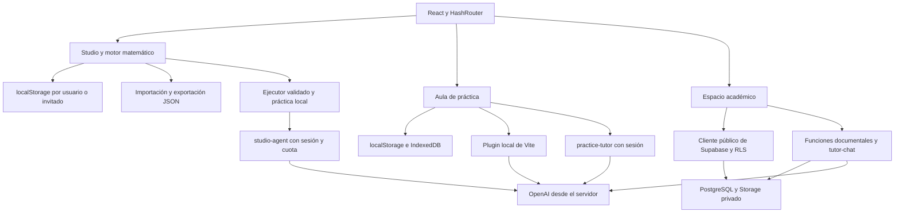

# Arquitectura actual de Fontex

**Revisión:** 11 de noviembre de 2026 · Fontex Agent integrado en `main`, con respaldo de la base `1d627cc` en `backup/main-before-fontex-agent-20261111` · versión declarada `0.6.0`.

## Experiencias y fronteras

Fontex es una SPA estática con React, TypeScript y Vite. La entrada principal es Studio. El laboratorio de fracciones, el aula de práctica y el espacio académico permanecen disponibles como rutas independientes.

La separación local por usuario organiza los datos en el navegador. No es aislamiento frente a otras personas con acceso al mismo perfil del navegador y no sincroniza datos con el servidor.

## Organización del código

| Ruta | Responsabilidad |
|---|---|
| `src/main.tsx` | React, temas, autenticación y HashRouter |
| `src/app/App.tsx` | Experiencias, rutas y guardas de sesión |
| `src/app/layouts/AppShell.tsx` | Navegación académica y selección de aula |
| `src/core/document-schema` | Objetos y validación de materiales versión 1 |
| `src/core/math-engine` | Fracciones, sucesiones, colecciones, rectas y ecuaciones lineales exactas |
| `src/core/agent` | Acciones, contratos, contexto calculado, esquema de salida y práctica determinista |
| `src/core/object-registry` | Catálogo y plantillas |
| `src/features/studio` | Editor, historial, presentación y guardado local |
| `src/features/demo` | Práctica, progreso, PDF locales y selección del tutor |
| `src/features/auth`, `workspace` | Sesión, perfil y aula activa |
| `src/features/library`, `tutor` | Biblioteca remota y tutor documental |
| `src/lib/supabase` | Configuración pública, cliente y contratos tipados |
| `supabase/migrations`, `tests` | Esquema versionado y pruebas de permisos |
| `supabase/functions` | Endpoints y lógica compartida |

## Studio

`StudioShell` monta un editor con una clave React derivada del usuario o de `guest`; cambiar de cuenta reinicia el estado y recupera su espacio local. `CanvasViewport` gestiona movimiento con puntero y teclado. `PropertiesInspector` valida formularios; `MathObjectRenderer` presenta SVG y texto.

Los cuatro tipos originales se conservan, junto a colecciones de enteros, recta numérica y ecuaciones lineales. El motor original sigue aceptando suma/resta de dos fracciones no negativas con resultado no negativo. `src/features/canvas/fractions.ts` reexporta el motor para mantener el laboratorio anterior.

`useStudioDocument` mantiene hasta 40 estados previos. Los cambios aplicados, deshacer y rehacer intentan guardar inmediatamente; el arrastre confirma un cambio al soltar. `document-store` reemplaza una instantánea completa bajo `fontex-studio-v2:<propietario>`: documentos y material activo cambian juntos mediante un único `setItem`. Lee el formato anterior y solo elimina sus claves después de confirmar la nueva instantánea. Si falla guardar el material nuevo, el editor conserva el actual y devuelve el error al llamante.

Importar valida el formato y asigna un nuevo ID al material. Exportar descarga el documento completo como JSON. No existen tablas remotas para los materiales. `studio-agent` propone cambios sin guardarlos: el cliente los valida, exige vista previa y los confirma en un único paso del historial. Practicar se calcula localmente; Aprender/Resolver usan la función autenticada con contexto y cuota existentes. Los detalles están en [studio.md](studio.md) y [fontex-agent.md](fontex-agent.md).

## Identidad, aulas y permisos

`AuthProvider` maneja sesión, perfil, alta, confirmación, reenvío de correo y cierre de sesión. El perfil opcional no bloquea el acceso si su consulta falla. El nombre visible puede venir de metadatos del usuario; las decisiones de rol se basan en matrículas de PostgreSQL.

Con Supabase configurado, Studio y las rutas locales siguen accesibles sin cuenta; las rutas académicas muestran autenticación a usuarios anónimos. Sin configuración, el cliente es nulo y permanecen componentes de demostración. Esto no habilita operaciones reales de backend.

`WorkspaceProvider` consulta aulas y roles con el token del usuario. Las invitaciones almacenan hashes de tokens de un solo uso; las membresías y roles pertenecen a `class_members`. Crear el primer workspace requiere autorización en `private.workspace_bootstrap_authorizations`; una cuenta pública no la recibe automáticamente.

Las migraciones habilitan RLS. Las ayudas privilegiadas fijan `search_path = ''` y califican relaciones. Las RPC internas de búsqueda, cuotas y escritura del tutor restringen su ejecución a `service_role`. La migración de endurecimiento revoca privilegios heredados de las cinco tablas del tutor; el navegador gestiona conversaciones y lee su historial, mientras mensajes y citas se escriben desde el servidor. Las políticas restantes evalúan la identidad con subconsultas para evitar recalcularla por fila.

## Biblioteca y RAG

El bucket `fontex-documents` es privado. La reserva de carga verifica membresía y cuotas; `document-upload` valida reserva, propietario, tamaño, firma PDF y hash antes de escribir con privilegios de servidor. `document-delete` elimina el objeto y sus metadatos. El navegador descarga con la sesión y permisos actuales, sin URLs públicas.

`document-process` descarga el PDF desde Storage, comprueba hash y páginas, extrae texto con PDF.js y genera chunks por página. Los trabajos tienen lease, progreso y versión; la indexación se reanuda por lotes. Un trabajo incompleto no participa en recuperación. El código usa embeddings de 1536 dimensiones y `text-embedding-3-small` por defecto.

`document-search` expone el diagnóstico de recuperación. La RPC combina similitud por coseno y texto completo mediante RRF, filtra por identidad y alcance, y exige un índice completo. Los clientes no leen directamente los chunks. El piloto usa búsqueda vectorial exacta; no hay índice HNSW implementado en las migraciones actuales.

Los límites iniciales son 5 MiB/100 páginas por PDF, 10 documentos/50 MiB por usuario, 500 MiB por aula y 750 MiB globales. Son valores del esquema, no garantías sobre un proyecto remoto. No hay OCR.

## Tutor documental

La ruta `/#/tutor` usa `TutorPage`, `useTutor`, `ChatArea` y `tutorService`. `FontexRuntimeProvider`, `ChatThread` y `tutorRuntime` conservan la integración anterior con assistant-ui; no montan la conversación de esta ruta.

Flujo de `tutor-chat`:

1. Autentica y valida aula, mensajes y opciones.
2. Reserva una consulta con `internal_begin_tutor_request`.
3. Comprueba o crea una conversación del usuario.
4. Genera el embedding y llama a `internal_search_tutor_chunks` con identidad, aula y fuentes.
5. En modo estricto, si no recupera fragmentos, se abstiene; con contexto, consulta Responses API.
6. Filtra las citas del modelo contra los chunks recuperados.
7. Persiste pregunta, respuesta y citas con `internal_store_tutor_exchange`, que bloquea brevemente la conversación, asigna índices crecientes y deriva las referencias de los chunks autorizados. Un fallo revierte todo el intercambio.
8. Completa el evento de uso tanto en éxito como en error. La finalización es idempotente y se reintenta una vez si falla su confirmación; un fallo persistente se informa como error.

El modo comparativo permite contexto general identificado como complemento. La tutoría guiada modifica las instrucciones pedagógicas. El modelo se selecciona mediante `OPENAI_MODEL`, la configuración de base y un respaldo de código `gpt-6-astra`. Se envía `store: false`. El nombre configurado no demuestra disponibilidad ni precio.

Las conversaciones, mensajes, citas y eventos tienen tablas propias. Las políticas de lectura separan usuarios, incluidos docentes y estudiantes. Al abrir una cita se vuelve a descargar el PDF con permisos actuales.

El modo estricto se abstiene si la salida no cumple el contrato JSON o no tiene citas válidas. Las referencias se limitan al contexto enviado y se vuelven a comprobar en PostgreSQL al guardar. Esto no verifica automáticamente el respaldo semántico de cada afirmación.

El prompt respeta `max_input_tokens` mediante una estimación conservadora de bytes UTF-8 más margen de formato: prioriza pregunta e instrucciones, selecciona fragmentos completos y después añade historial reciente. Si lo obligatorio no cabe, rechaza la consulta y libera la reserva. No es un tokenizer específico del modelo y puede aprovechar menos contexto que el límite nominal.

El hook de conversación cancela e ignora envíos obsoletos al cambiar de conversación/aula o desmontarse. Tras el envío recupera los mensajes persistidos para presentar el historial canónico. La reserva SQL también serializa el presupuesto global, además de las cuotas por usuario. Las regresiones están en la [auditoría](../AUDITORIA.md).

## Aula de práctica

`/#/demo` usa `practice/lessons.json`: fracciones, decimales, proporciones y funciones. Guarda progreso en `localStorage` y PDF en IndexedDB por cuenta/tema. El contenido del invitado no se transfiere automáticamente a una cuenta.

La búsqueda local por términos y chunks selecciona fragmentos; es distinta de la recuperación vectorial del backend. Sin IA, el estudio conserva consulta local y ejercicios.

`tutorAvailable` prueba primero el endpoint local de Vite en localhost. Si no está disponible y existe sesión, prueba `practice-tutor`. El endpoint remoto autentica, limita el cuerpo a 10.000 bytes y reserva cuota mediante `take_practice_tutor_quota`: 10 llamadas por hora UTC y 25 por día UTC, por cuenta. Estas cuotas son independientes de `tutor-chat` y la reserva se consume aunque falle el proveedor.

Los modos `chat`, `study` y `web` usan `practice/tutor.ts`. `web` restringe dominios y exige al menos una cita HTTPS permitida. La evidencia de estudio enviada por el navegador es material del cliente; no acredita acceso a la biblioteca privada.

## Hosting y configuración

`HashRouter` evita necesitar reescrituras de SPA en GitHub Pages. `VITE_BASE_PATH` controla los assets al compilar: `/` por defecto o `/fontex-web/` para el dominio estándar del repositorio.

Pages compila y publica solo el frontend. El workflow incluye respaldo de URL y clave publicable del piloto; omitir variables no desconecta ese backend. Las funciones y migraciones se despliegan por separado. `OPENAI_API_KEY` solo se lee en Edge Functions o en el servidor local de Vite.

CI comprueba frontend, pgTAP local y Deno. Las suites remotas dependen de variables adicionales y pueden omitirse; Vitest correcto no implica una prueba de producción.

## Diseño y verificación

Studio, Fracciones, Práctica y el espacio académico usan tokens compartidos de `globals.css` y el mismo `ThemeProvider`. Los alias `--st-*`, `--fc-*` y `--fd-*` referencian esos colores; los SVG usan tokens matemáticos que cambian con el tema. Cada experiencia expone un selector de luna/sol. Hay controles etiquetados y movimiento por teclado, pero las pruebas actuales no sustituyen una revisión de teclado, lector de pantalla y responsive en navegador real.

La revisión ejecutó checks locales y análisis estático. No verificó el sitio publicado, la configuración remota, una conversación pagada ni pruebas E2E. Los resultados están en [AUDITORIA.md](../AUDITORIA.md).
