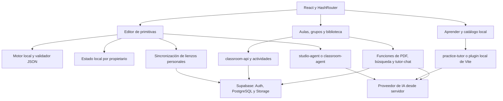

# Arquitectura actual de Fontex

Revisión: 22 de noviembre de 2026, serie 1.0. La arquitectura anterior se conserva en [el archivo histórico](../archive/overview-pre-v1.md).

## Ejecución

`src/main.tsx` monta tema, Auth, participación temporal, límite de errores y `HashRouter`. `src/app/App.tsx` conecta todas las rutas activas. El editor es `PrimitiveCanvas`; los nombres anteriores `/laboratorio`, `/fracciones` y `/lienzo-clasico` son aliases del editor actual.

## Responsabilidades

| Directorio | Responsabilidad vigente |
| --- | --- |
| `src/app` | Rutas, errores y estructura de la aplicación |
| `src/core/primitives` | Contrato v2, doce familias, cálculo, representación 3D, interacción permitida y plantillas |
| `src/core/scene` | Parser de expresiones compartido y discriminadores de formatos |
| `src/core/math-engine/math-notation.ts` | Normalización de potencias compartida; sigue activa |
| `src/core/agent` | Intención chat/construcción, streaming y presupuestos de generación |
| `src/features/primitives` | Editor, propiedades, historial, presentación, PDF y recuperación de construcciones |
| `src/features/classrooms` | Invitaciones, participación temporal, publicación, actividades y entregas |
| `src/features/library`, `tutor` | PDF, lienzos personales, fuentes, conversaciones y citas |
| `src/features/demo` | Catálogo local Aprender y progreso |
| `src/features/auth`, `workspace`, `beta`, `administration` | Sesión y permisos de acceso |
| `supabase/functions` | Validación, cuotas, proveedor y operaciones de backend |
| `supabase/migrations`, `supabase/tests` | Historia del esquema y pruebas SQL/RLS |

## Fronteras de datos y permisos

El navegador usa una clave pública y la sesión del usuario. Los secretos del proveedor y la clave administrativa permanecen en las funciones. Las decisiones de acceso se basan en membresías y autorización del servidor, no en nombres ni roles editables del perfil.

`WorkspaceProvider` selecciona el aula activa de la cuenta. Las clases, archivos y entregas se consultan con permisos de aula. La invitación temporal da un token con alcance y vencimiento: no concede una sesión administrativa de Supabase. El flujo de vinculación valida el token en servidor antes de crear la membresía permanente.

El almacenamiento local separa propietarios lógicamente, pero no protege frente a otra persona con acceso al mismo perfil del navegador. Los lienzos remotos se sincronizan por propietario con revisiones y resolución conservadora de conflictos; los PDF usan Storage privado y permisos documentales.

## Compatibilidad

El formato del editor es `primitive-scene`, `schemaVersion: 2`. Los discriminadores de sobres anteriores evitan mezclar tipos de contenido en `visual_scenes`. El endpoint `scene-agent` es una respuesta de retirada 410 para clientes autenticados antiguos; no genera contenido ni consume IA. Se conserva su prueba y su comprobación de acceso.

Se retiraron los editores desconectados `FractionCanvas` y `GeneralCanvas`, el chat anterior de assistant-ui y sus motores auxiliares sin consumidores activos. No se borraron datos del navegador, archivos personales, tablas, migraciones, rutas compatibles ni avisos de licencia.

## Verificación

CI tiene tres grupos: calidad de aplicación, funciones Edge y seguridad de base de datos. Las pruebas de proveedor habituales son simuladas. Los E2E cubren móvil y escritorio, temas, publicación de clases, invitados, PDF y cuerpos 3D. Las pruebas remotas y los envíos reales de correo son verificaciones aparte.

Consulta [editor](studio.md), [agente](fontex-agent.md), [backend](../../supabase/README.md) y [auditoría](../AUDITORIA-2026-11-22.md).
